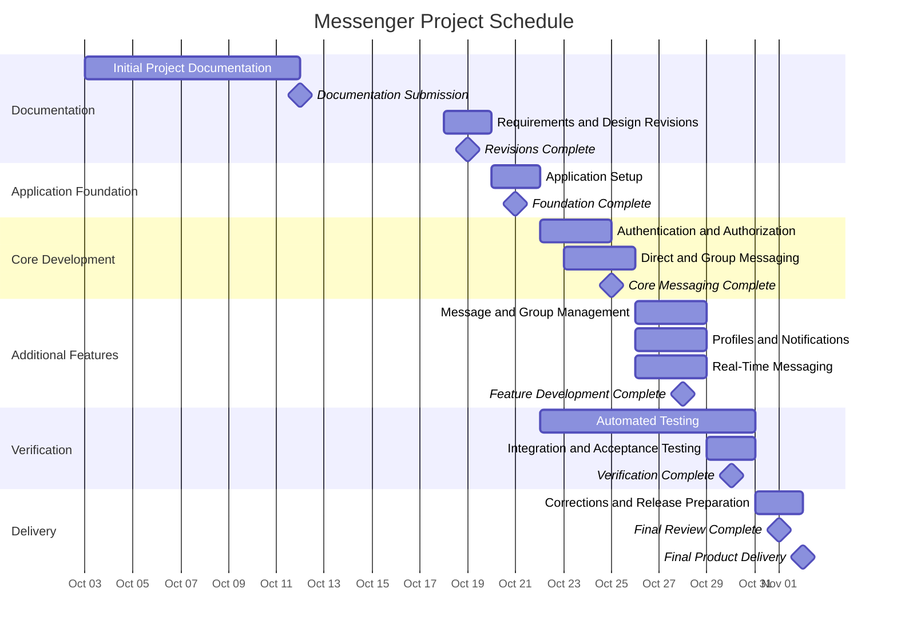

# Statement of Work

**Project:** Messenger Application
**Student:** Sean Hamilton
**Course:** CPS 490 - Capstone I

**Document Status:** Draft
**Last Revised:** October 18, 2026

**Submission Date:** October 12, 2026
**Project Delivery Deadline:** November 2, 2026

---

## Revision History

| Date | Revision | Description |
|---|---|---|
| October 12, 2026 | Initial Draft | Established the original project objectives, stakeholders, scope, deliverables, schedule, and acceptance criteria for Messenger. |
| October 18, 2026 | IA-06 Implementation Revisions | Updated the Statement of Work to reflect the implementation requirements established by IA-06. Changes include account registration and authentication, persistent messaging, real time communication, server side authorization, the required technology stack, revised project milestones, and expanded acceptance criteria. The additional features established in the original project scope have been retained. |

---

## 1. Project Purpose and Objectives

**Project Purpose**
The purpose of the Messenger project is to develop a communication application that allows registered users to exchange private messages and participate in group conversations. The system will provide users with a centralized platform where they can create accounts, securely access their conversations, exchange messages in real time, and retrieve previously sent messages. The project will focus on implementing these core communication capabilities while ensuring that user identities are verified and conversations are accessible only to authorized participants. The completed application will be developed using the required course technologies and will be tested and documented to demonstrate that it meets the agreed upon requirements before the November 2, 2026, delivery deadline.

**Project Objectives**

The major objectives of the project are:

1. **User Registration and Authentication:** Allow users to create accounts, securely log in and log out, and access Messenger through authenticated sessions.

2. **User Communication:** Allow registered users to exchange private messages and communicate with multiple users through group based messaging.

3. **Group Management:** Allow users to create messaging groups and manage group membership, providing an organized way for multiple users to communicate.

4. **Message Management:** Allow users to access their previous conversations, retrieve message history, and edit or delete messages they have previously sent.

5. **Real Time Messaging and Notifications:** Allow users to receive new messages in real time without manually refreshing the application and provide notifications about new messages.

6. **User Profiles:** Allow registered users to maintain basic profiles that identify them within the application.

7. **Security and Data Persistence:** Ensure that messages are stored persistently and that only authorized participants can access and contribute to their conversations.

8. **Project Completion and Verification:** Deliver a functional Messenger application that satisfies the agreed upon requirements, includes documented testing and verification results, and can be installed and run from a clean repository checkout before the November 2, 2026, deadline.

## 2. Stakeholders

The Messenger project involves several stakeholders who contribute to its development, define its requirements, or interact with the completed application.

1. **Client:** The client is responsible for communicating the project's expectations, clarifying requirements, and reviewing the completed Messenger application to determine whether it meets the agreed upon objectives.

2. **Software Developer:** The software developer is responsible for designing, implementing, integrating, and testing Messenger. The developer will also maintain the project documentation, address technical issues, and ensure the completed application meets its functional and security requirements.

3. **Project Manager:** The project manager is responsible for coordinating development activities, monitoring project milestones, managing the schedule, and identifying potential risks that could affect delivery. For this individual project, these responsibilities will be performed by the software developer.

4. **End Users:** Registered users are the primary users of Messenger. They will use the application to exchange private messages, participate in group conversations, manage their profiles, and interact with the other messaging capabilities.

## 3. Scope

### 3.1 In Scope

The Messenger project will focus on developing the functionality necessary for registered users to communicate through private and group messaging. The application will support secure user authentication, persistent message storage, real time communication, and access controls that restrict conversations to authorized participants. The following capabilities are included in the project scope.

1. **User Registration and Authentication:** Users will be able to create accounts, log in, identify their authenticated account, and log out. Passwords will be securely hashed, and authenticated sessions will be managed using JSON Web Tokens (JWT).

2. **Private Messaging:** Authenticated users will be able to create or access direct conversations with other registered users and exchange private messages. The application will prevent unintended duplicate direct conversations between the same two users.

3. **Group Messaging:** Authenticated users will be able to participate in group conversations involving multiple registered users and exchange messages with other group members.

4. **Group Management:** Users will be able to create messaging groups and manage group membership. Membership changes will be subject to the application's authorization rules.

5. **Message History and Persistence:** Authorized users will be able to retrieve messages from their previous conversations. Messages and conversation data will be stored persistently so that message history remains available after users log out or the backend restarts.

6. **Message Editing and Deletion:** Users will be able to edit or delete messages they have previously sent. These operations will be restricted to the original sender and verified by the backend.

7. **Real Time Messaging and Notifications:** Users will be able to receive new messages in real time without manually refreshing the application. The application will also provide notifications about new messages, with the specific notification behavior defined in the requirements document.

8. **User Profiles:** Registered users will be able to view and maintain basic profile information that identifies them within the application.

9. **Authorization and Conversation Privacy:** The application will verify user identities and enforce conversation membership restrictions. Users who are not authorized participants will be prevented from reading messages, sending messages, or subscribing to a conversation's real time events.

10. **Browser Interface:** Messenger will provide a browser based interface for registration, login, direct messaging, group messaging, message history, and the additional features included in the project scope. The interface will communicate loading, empty, validation, and connection failure states.

11. **Testing and Verification:** The application will undergo automated and manual testing to verify its functionality, security, persistence, and real time communication. Testing will include successful operations, rejected operations, and a reproducible demonstration involving multiple registered users.

12. **Application Documentation and Release:** The project will include the source code, configuration examples, setup instructions, implementation documentation, and verification results necessary to install, run, and test Messenger from a clean repository checkout.

### 3.2 Out of Scope

The Messenger project will focus on delivering its agreed upon communication capabilities. To maintain a manageable project scope and meet the required delivery deadline, the following features will not be included.

1. **Mobile Applications:** The project will not include the development of dedicated applications for mobile devices.

2. **External Application Integration:** Messenger will not support integrations with external applications or third party services.

3. **Advanced Message Encryption:** The project will not include advanced encryption capabilities, such as end to end message encryption, beyond the standard security protections required for the application.

4. **Voice and Video Calling:** Messenger will focus on text messaging and will not support voice or video communication.

5. **Screen Sharing:** Users will not be able to share their screens with other users through Messenger.

6. **Advanced User Roles and Moderation:** The project will not include advanced administrative permission systems, moderation tools, or specialized user roles. Basic group membership management and the authorization controls necessary to protect user accounts and conversations will remain within the project scope.

## 4. Deliverables

The Messenger project will produce several deliverables throughout its development. These deliverables are organized around two important deadlines: October 12, 2026, for the initial project documentation and November 2, 2026, for the completed Messenger application and its supporting verification materials.

### 4.1 October 12, 2026: Project Documentation

The following four documents were completed and submitted to the individual course GitHub repository by October 12, 2026.

1. **Statement of Work:** A document defining the project's purpose, objectives, stakeholders, scope, deliverables, assumptions, constraints, dependencies, schedule, and acceptance criteria.

2. **Requirements Document:** A document defining and analyzing the functional and nonfunctional requirements for the proposed Messenger application.

3. **Diagrams and Analysis:** Documentation containing the required system diagrams and supporting analysis to describe and examine the proposed Messenger system.

4. **Ethics Reflection:** A document examining ethical considerations associated with developing and using the proposed Messenger application.

These documents established the initial project expectations and provided a foundation for implementation. Revisions made during development will be documented to ensure that the requirements, diagrams, and other project materials remain consistent with the completed application.

### 4.2 November 2, 2026: Final Product Delivery

The completed Messenger application and its supporting materials will be delivered no later than November 2, 2026. The following deliverables will demonstrate that the agreed upon functionality has been implemented and verified.

1. **Functional Messenger Application:** A working browser based application that supports user registration and authentication, private messaging, group messaging, group membership management, persistent message history, message editing and deletion, real time communication, notifications, and basic user profiles. The application will enforce authorization rules to protect user accounts and conversations.

2. **Application Source Code:** The completed frontend and backend source code, automated tests, dependency files, Docker Compose configuration, and supporting files required to install, build, and run Messenger using the prescribed course technologies.

3. **Testing and Verification Results:** Automated test results and documented manual acceptance tests demonstrating that the application meets its functional, security, persistence, and real time communication requirements. Verification will include both successful operations and rejected or invalid operations.

4. **Implementation Report:** A document connecting important requirement identifiers to the corresponding implementation components, endpoints, verification procedures, and observed results. The report will also document relevant engineering decisions, changes, and known limitations.

5. **Application Documentation:** A root README containing the prerequisites, installation instructions, configuration examples, startup commands, testing procedures, troubleshooting guidance, and release instructions necessary to run Messenger from a clean repository checkout.

6. **Verification Documentation:** A reproducible verification guide describing the steps, commands, expected outcomes, and observed results for the application's major behaviors, including a multiuser demonstration of direct messaging, group messaging, real time delivery, persistent history, and unauthorized access rejection.

7. **Final Product Demonstration:** A demonstration of the completed application using multiple registered accounts to show that its major communication capabilities operate as intended, including live message delivery, recovery of missed messages, and enforcement of conversation membership restrictions.

8. **Final Repository Submission:** The completed application, supporting documentation, configuration examples, tests, and verification evidence will be committed and pushed to the individual course GitHub repository by the November 2, 2026, deadline.

## 5. Assumptions, Constraints, and Dependencies

### 5.1 Assumptions

The following assumptions have been identified for the Messenger project. These conditions will guide implementation and will be reviewed as development progresses.

1. **User Account Creation:** It is assumed that users will create their own accounts through Messenger rather than relying on an externally provided set of registered identities. The application will support account registration, login, logout, and authenticated access using the required course technologies.

2. **Notification Behavior:** It is assumed that notifications about new messages can be provided within the Messenger browser interface using the application's real-time communication capabilities. The specific notification behavior will be defined in the requirements document before implementation.

3. **Local Development and Release:** It is assumed that Messenger can be developed, tested, and demonstrated using a local environment without requiring a publicly hosted deployment. The completed application must be reproducibly runnable from a clean repository checkout.

4. **Development Resources:** It is assumed that the necessary development tools, software, and resources will remain available throughout the implementation period.

5. **Testing Resources:** It is assumed that multiple registered test accounts and independent browser sessions can be used to verify private messaging, group messaging, real time delivery, message persistence, and authorization behavior.

### 5.2 Constraints

The following constraints establish the boundaries and requirements that the Messenger project must follow.

1. **Project Documentation Deadline:** The Statement of Work, Requirements Document, Diagrams and Analysis, and Ethics Reflection were required to be completed and submitted to the individual course GitHub repository by October 12, 2026. Any revisions made during implementation must be documented and kept consistent with the completed application.

2. **Final Product Deadline:** The completed Messenger application, source code, testing results, and supporting documentation must be delivered no later than November 2, 2026. The development schedule must allow sufficient time for integration, testing, corrections, and final review.

3. **Project Scope:** Development will be limited to the functionality defined in Section 3. The application must satisfy the minimum requirements established by IA-06 while also implementing the additional features retained in the agreed upon project scope.

4. **Required Technology Stack:** Messenger must use Node.js 24 LTS and Express for the backend API, MongoDB with Mongoose for persistent storage, React with Vite for the browser interface, bcrypt for password hashing, JWT for authenticated sessions, Socket.IO for real time communication, and Docker Compose for local MongoDB. Git and GitHub will be used for version control and submission. Supporting libraries may be used when appropriate, but the prescribed technologies cannot be replaced.

5. **Authentication and Authorization:** Messenger must support account registration, login, authenticated account identification, and logout. Passwords must be stored as bcrypt hashes, and protected operations must verify JWTs. The backend must enforce conversation membership authorization for both HTTP requests and Socket.IO events rather than relying on information supplied by the browser.

6. **Data Persistence:** User accounts, conversations, and messages must be stored persistently using MongoDB. Message history must remain available after users log out or the backend restarts.

7. **Testing and Verification:** The application must include reproducible automated tests and documented manual acceptance testing. Verification must cover successful operations, invalid inputs, unauthorized access attempts, persistent message history, and real-time delivery. Testing must use disposable data that is isolated from normal development data.

8. **Reproducible Release:** The completed application must be installable, runnable, and testable from a clean repository checkout using documented instructions. A publicly hosted deployment is not required, but the local release must include the necessary configuration examples, startup commands, testing procedures, and troubleshooting guidance.

9. **Repository Requirements:** The required source code, documentation, automated tests, and supporting configuration files must be organized, committed, and pushed to the individual course GitHub repository. Credentials, environment files containing secrets, personal database dumps, installed dependencies, and generated build output must not be committed.

### 5.3 Dependencies

The Messenger project depends on several technical resources, development decisions, and supporting materials that may affect implementation and final delivery.

1. **Requirements and Design Documentation:** Development depends on the requirements, diagrams, and analysis established during the earlier Messenger assignments. These materials must be reviewed before implementation and revised when necessary to reflect changes introduced by IA-06 or decisions made during development.

2. **Development Tools and Resources:** The project depends on access to the required development environment and course technologies, including Node.js 24 LTS, Express, MongoDB, Mongoose, React, Vite, bcrypt, JWT, Socket.IO, Docker Compose, and Git. These tools must be installed and configured correctly to support development and testing.

3. **Database Availability:** Messenger depends on MongoDB being available to store and retrieve user accounts, conversations, and messages. Docker Compose will be used to manage the local database service, and the application must handle database connection failures appropriately.

4. **Authentication and Authorization Implementation:** Protected messaging functionality depends on the successful implementation of account registration, login, JWT verification, and server side authorization. User identity and conversation membership must be verified before allowing access to protected messaging operations.

5. **Real-Time Communication:** Live message delivery and notifications depend on Socket.IO being integrated with the backend and browser interface. Real time communication must use authenticated connections and enforce conversation membership restrictions.

6. **Testing Resources:** Verification depends on having multiple registered test accounts, independent browser sessions, and an isolated testing environment. These resources will be used to verify authorized and unauthorized operations, persistent message history, real time delivery, and recovery after users reconnect.

7. **Course Repository Access:** Final submission depends on continued access to the individual course GitHub repository. The completed source code, documentation, tests, and verification evidence must be committed and pushed to the repository by the November 2, 2026, deadline.

## 6. Milestones and Schedule

### 6.1 Project Milestones

The Messenger project will follow a schedule designed to complete implementation, integration, and verification before the November 2, 2026, delivery deadline. The schedule reflects the required functionality established by IA-06 while accounting for the additional features retained in the project scope.

The following milestones establish the revised project timeline.

| Milestone | Target Date | Description |
|---|---|---|
| Project Documentation | October 12, 2026 | Complete and submit the four initial project documents. |
| Requirements and Design Revisions | October 19, 2026 | Review and update the Statement of Work, requirements, and diagrams to reflect IA-06 and the selected implementation approach. |
| Application Foundation | October 21, 2026 | Establish the Node.js and Express backend, MongoDB database, React interface, project configuration, and initial API communication. |
| Authentication and Core Messaging | October 25, 2026 | Implement account registration, login, JWT authentication, conversation authorization, persistent direct messaging, and group messaging. |
| Additional Feature Development | October 28, 2026 | Implement message editing and deletion, group membership management, notifications, user profile management, and real time message delivery. |
| Integration and Verification | October 30, 2026 | Complete automated tests, multiuser acceptance testing, security checks, persistence verification, and integration corrections. |
| Final Review and Release Preparation | November 1, 2026 | Review documentation, resolve remaining issues, verify clean checkout setup, and prepare the final repository submission. |
| Final Product Delivery | November 2, 2026 | Commit and push the completed Messenger application, source code, documentation, tests, and verification evidence to GitHub. |

### 6.2 Project Gantt Chart

The following Gantt chart illustrates the revised development schedule for Messenger. It identifies the major project activities, their planned durations, and the milestones leading up to final delivery. The schedule prioritizes authentication and core messaging functionality while allowing time for additional feature development, integration, testing, corrections, and final review before the November 2 deadline.

### 6.3 Activity Dependencies

The Messenger project schedule includes several dependencies that determine when development activities can begin and how the application's components will be integrated.

1. **Requirements and Design Revisions:** The Statement of Work, requirements, and diagrams must be reviewed and updated to reflect the implementation expectations established by IA-06. These revisions will guide development and help ensure that the completed application remains consistent with the project documentation.

2. **Application Foundation:** The development environment, backend API, database connection, and browser interface must be established before the application's major features can be integrated and tested.

3. **Authentication and Authorization:** Account registration, login, JWT verification, and server side authorization must be implemented to support secure access to Messenger. Protected messaging operations depend on verified user identities and conversation membership restrictions.

4. **Core Messaging Development:** Private and group messaging depend on the application's authentication, authorization, and persistent data components. These capabilities must be integrated so that registered users can create conversations, exchange messages, and retrieve their message history.

5. **Additional Feature Development:** Message editing and deletion, group membership management, notifications, and user profile management depend on the core application components. These features must follow the same authentication and authorization rules established for the primary messaging functionality.

6. **Real-Time Communication:** Live message delivery depends on the messaging API, persistent message storage, authenticated Socket.IO connections, and conversation membership authorization. Messages must be stored successfully before real time delivery events are sent to authorized participants.

7. **Testing and Verification:** Automated testing will be performed throughout development as individual components become available. Full integration and acceptance testing depend on the required features being implemented and will verify successful operations, rejected operations, persistent message history, real-time delivery, and recovery after reconnection.

8. **Corrections and Final Review:** Issues identified during development and testing must be addressed before the final application review. The completed application and documentation must also be checked for consistency with the requirements and acceptance criteria.

9. **Final Delivery:** The completed application, source code, automated tests, verification results, implementation report, and supporting documentation must be prepared, committed, and pushed to the individual course GitHub repository by November 2, 2026.

## 7. Acceptance Criteria

The Messenger project will be considered complete when the agreed upon deliverables satisfy the following acceptance criteria. These criteria establish how the client and software developer will verify that the project objectives have been achieved.

### 7.1 Project Documentation

The initial documentation deliverables due October 12, 2026, must satisfy the following criteria. Any revisions made during implementation must also be documented and maintained as part of the final project submission.

1. **Statement of Work:** The document identifies the project's objectives, stakeholders, scope, deliverables, assumptions, constraints, dependencies, schedule, and acceptance criteria. It also includes a Gantt chart illustrating the proposed development schedule.

2. **Requirements Document:** The document identifies and analyzes the Messenger application's functional and nonfunctional requirements, including its communication capabilities, security requirements, and relevant constraints. Requirements must use stable identifiers that can be referenced during implementation and verification.

3. **Diagrams and Analysis:** The required system diagrams and supporting analysis are completed and accurately represent the proposed Messenger system. Diagrams must be reviewed and updated when implementation decisions introduce changes to the documented design.

4. **Ethics Reflection:** The document addresses ethical considerations associated with developing and using the Messenger application, including relevant privacy, security, and user impact concerns.

5. **Repository Submission:** All four initial documents and their required supporting files must have been organized, committed, and submitted to the designated course GitHub repository by October 12, 2026.

6. **Documentation Revisions and Traceability:** Changes identified during implementation must be reflected in the appropriate project documents and accompanied by an explanation of the revision. Important requirement identifiers must be connected to their implementing components, verification procedures, and observed results in the implementation report.

### 7.2 Application Acceptance Criteria

The Messenger application must satisfy the following acceptance criteria before final delivery on November 2, 2026. These criteria establish how the application's required functionality, security, persistence, and supporting deliverables will be verified.

1. **User Registration and Authentication:** Users must be able to register accounts, log in with valid credentials, identify their authenticated account, and log out. During acceptance testing, the developer will demonstrate successful registration and login, rejection of invalid credentials, and rejection of protected requests without a valid JWT. Passwords must be stored as bcrypt hashes rather than plain text.

2. **Private Messaging:** Authenticated users must be able to create or access direct conversations with other registered users and exchange private messages. During acceptance testing, the developer will demonstrate that Alice and Bob can exchange messages through independent browser sessions and that creating or accessing their direct conversation does not unintentionally produce duplicates.

3. **Group Messaging:** Authenticated users must be able to create and participate in group conversations involving multiple registered users. During acceptance testing, the developer will demonstrate that Alice can create a group with Bob and Carol and that each authorized member can read and contribute messages within the correct conversation.

4. **Group Management:** Users must be able to manage group membership according to the application's authorization rules. During acceptance testing, the developer will demonstrate that an authorized user can add and remove group members, that membership changes are reflected correctly, and that removed or unauthorized users cannot access protected group messages.

5. **Message History and Persistence:** Authorized users must be able to retrieve previously exchanged messages in the correct conversation and in a consistent order. During acceptance testing, the developer will demonstrate that message history remains available after a user logs out and logs back in and after the backend restarts.

6. **Message Editing and Deletion:** Users must be able to edit or delete messages they have previously sent. During acceptance testing, the developer will demonstrate that the original sender can modify or delete a message and that the resulting changes are reflected in the conversation. Attempts by other users to edit or delete messages they did not send must be rejected.

7. **Real-Time Messaging:** Authorized users must receive new messages without manually refreshing the application. During acceptance testing, the developer will demonstrate that a message sent by Alice appears in Bob's open conversation through Socket.IO and that messages are successfully stored before delivery events are emitted.

8. **Notifications:** Users must receive notifications about new messages according to the behavior established in the requirements document. During acceptance testing, the developer will demonstrate that an incoming message produces the expected notification and that the notification accurately reflects the associated conversation.

9. **User Profiles:** Registered users must be able to view and maintain their basic profile information. During acceptance testing, the developer will demonstrate that a user can access their profile, modify permitted information, and verify that the updated information is displayed correctly and remains available after reloading the application.

10. **Authorization and Conversation Privacy:** Only authorized participants must be able to access and contribute to their conversations. During acceptance testing, the developer will demonstrate that an unrelated user cannot retrieve private messages, submit messages to an unauthorized conversation, or subscribe to its Socket.IO events. These restrictions must be enforced by the backend rather than relying on the browser interface.

11. **Offline Message Recovery:** Users who are disconnected or logged out must be able to retrieve messages sent during their absence. During acceptance testing, Bob will log out, Alice will send another message, and Bob will log back in and retrieve the missed message from persistent history.

12. **Usability and Failure Handling:** The application must provide clear feedback for authentication, loading, empty conversations, invalid inputs, message submission, and backend connectivity failures. During acceptance testing, the developer will demonstrate that invalid operations are handled appropriately, failed message submissions are not presented as successful deliveries, and duplicate submissions are prevented.

13. **System Testing and Verification:** The application must include reproducible automated tests and documented manual acceptance procedures covering its important functional and security requirements. During verification, the developer will execute tests for successful and rejected operations, document observed results, and identify any unresolved limitations. Testing must use disposable data isolated from normal development data.

14. **Final Delivery and Reproducible Release:** The completed Messenger application, source code, automated tests, implementation report, verification documentation, and supporting configuration files must be committed and pushed to the individual course GitHub repository by November 2, 2026. During final acceptance, the developer will demonstrate that the application can be installed, started, built, and tested from a clean repository checkout using the documented instructions.
